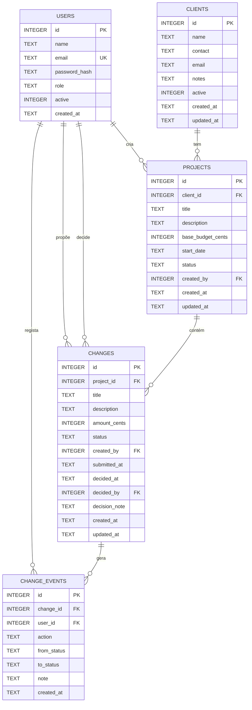

# Modelo relacional — ObraClara V2

Base de dados SQLite (`database/obraclara.sqlite`) definida em
[`database/schema.sql`](../database/schema.sql). Todas as ligações PDO executam
`PRAGMA foreign_keys = ON`.

## 1. Diagrama entidade-relação



## 2. Tabelas

### `users`
Utilizadores da aplicação.

| Campo | Tipo | Regra |
|---|---|---|
| `id` | INTEGER | chave primária |
| `name` | TEXT | obrigatório |
| `email` | TEXT | obrigatório, único (sem diferenciar maiúsculas) |
| `password_hash` | TEXT | `password_hash()`; nunca texto simples |
| `role` | TEXT | `gestor` ou `colaborador` |
| `active` | INTEGER | 0/1; conta inativa não autentica |
| `created_at` | TEXT | data/hora local (Europe/Lisbon) |

### `clients`
Clientes da empresa. O arquivo é lógico (`active = 0`), nunca apagamento.

| Campo | Tipo | Regra |
|---|---|---|
| `id` | INTEGER | chave primária |
| `name` | TEXT | obrigatório |
| `contact`, `email`, `notes` | TEXT | opcionais, validados na aplicação |
| `active` | INTEGER | 0/1 |
| `created_at`, `updated_at` | TEXT | datas |

### `projects`
Obras. Cada obra pertence a **um** cliente.

| Campo | Tipo | Regra |
|---|---|---|
| `id` | INTEGER | chave primária |
| `client_id` | INTEGER | FK → `clients(id)`, `ON DELETE RESTRICT` |
| `title` | TEXT | obrigatório |
| `description` | TEXT | opcional |
| `base_budget_cents` | INTEGER | `0 ≤ valor ≤ 9 999 999 999` cêntimos |
| `start_date` | TEXT | `YYYY-MM-DD` ou nulo |
| `status` | TEXT | `planeada`, `em_curso`, `concluida`, `arquivada` |
| `created_by` | INTEGER | FK → `users(id)`, `SET NULL` |
| `created_at`, `updated_at` | TEXT | datas |

### `changes`
Alterações ao âmbito (trabalhos adicionais). Cada alteração pertence a **uma** obra.

| Campo | Tipo | Regra |
|---|---|---|
| `id` | INTEGER | chave primária |
| `project_id` | INTEGER | FK → `projects(id)`, `RESTRICT` |
| `title` | TEXT | obrigatório |
| `description` | TEXT | opcional |
| `amount_cents` | INTEGER | `0 < valor ≤ 9 999 999 999` cêntimos |
| `status` | TEXT | `rascunho`, `pendente`, `aprovada`, `rejeitada` |
| `created_by` | INTEGER | FK → `users(id)`, autor |
| `submitted_at` | TEXT | preenchido na submissão |
| `decided_at` | TEXT | preenchido na decisão |
| `decided_by` | INTEGER | FK → `users(id)`, gestor decisor |
| `decision_note` | TEXT | observação da decisão |
| `created_at`, `updated_at` | TEXT | datas |

### `change_events`
Histórico imutável. Cada evento pertence a **uma** alteração e a **um** utilizador.

| Campo | Tipo | Regra |
|---|---|---|
| `id` | INTEGER | chave primária |
| `change_id` | INTEGER | FK → `changes(id)`, `CASCADE` |
| `user_id` | INTEGER | FK → `users(id)`, `RESTRICT` |
| `action` | TEXT | `criada`, `editada`, `submetida`, `aprovada`, `rejeitada` |
| `from_status` | TEXT | estado anterior (nulo na criação) |
| `to_status` | TEXT | estado resultante |
| `note` | TEXT | observação (ex.: motivo da rejeição) |
| `created_at` | TEXT | data/hora do evento |

## 3. Índices

- `users.email` — único (procura no login).
- `clients(active)`, `clients(name)`.
- `projects(client_id)`, `projects(status)`.
- `changes(project_id)`, `changes(status)`.
- `change_events(change_id)`, `change_events(created_at)`.

## 4. Integridade e regras na base de dados

Constraints (`CHECK`):

- papéis apenas `gestor`/`colaborador`, estados permitidos;
- `active` apenas 0/1;
- orçamento base não negativo;
- custo de alteração estritamente positivo;
- limite máximo de 99 999 999,99 € em cêntimos.

Chaves estrangeiras:

- uma obra não pode referir um cliente inexistente;
- não se apaga um cliente com obras;
- não se apaga uma obra com alterações;
- não se apaga um utilizador referenciado por alterações/eventos;
- apagar uma alteração (não exposto na aplicação) apagaria os seus eventos.

Triggers:

- `trg_changes_final_is_immutable` — bloqueia `UPDATE` a alterações aprovadas ou rejeitadas;
- `trg_changes_guard_status` — valida o estado;
- `trg_events_immutable_update` e `trg_events_immutable_delete` — o histórico não pode ser
  reescrito nem apagado.

## 5. Dinheiro em cêntimos

Todos os valores são inteiros. Um euro = 100 cêntimos.

```
orçamento atualizado = base_budget_cents
                     + Σ amount_cents (changes.status = 'aprovada')
```

Exemplo validado:

```
800 000 + 65 000 = 865 000 cêntimos = 8 650,00 €
```

A soma é feita em SQL (`SUM`) e em PHP com inteiros, nunca com `float`.
A apresentação usa `number_format` sobre euros e cêntimos separados:

```php
$euros = intdiv($cents, 100);
$resto = $cents % 100; // '8 650,00 €'
```

## 6. Datas

Guardadas como texto `Y-m-d H:i:s` no fuso `Europe/Lisbon` (configurado em
`config/config.php`), formatadas para `dd/mm/aaaa hh:mm` na interface.

## 7. Consultas centrais

Orçamento e custos aprovados de uma obra:

```sql
SELECT p.id, p.base_budget_cents,
       COALESCE((
           SELECT SUM(ch.amount_cents)
             FROM changes ch
            WHERE ch.project_id = p.id
              AND ch.status = 'aprovada'
       ), 0) AS approved_cents
  FROM projects p
 WHERE p.id = :id;
```

Alterações pendentes para o painel:

```sql
SELECT ch.*, p.title AS project_title, c.name AS client_name
  FROM changes ch
  JOIN projects p ON p.id = ch.project_id
  JOIN clients c ON c.id = p.client_id
 WHERE ch.status = 'pendente'
 ORDER BY ch.submitted_at ASC;
```

## 8. Invariantes testados

1. Rascunho/pendente/rejeitada não alteram o orçamento atualizado.
2. Apenas o gestor aprova ou rejeita, e apenas a partir de `pendente`.
3. Uma alteração decidida não pode ser editada nem decidida novamente.
4. Cada transição gera um evento com autor, data e transição.
5. O valor aprovado é a soma exata em cêntimos, inclusive com várias aprovações.
6. O histórico não pode ser alterado nem apagado.
7. IDs inexistentes e referências inválidas são recusados.
