# Manual de utilização — ObraClara V2

**Aplicação:** ObraClara V2 — gestão de alterações a obras
**Versão:** 29/10/2026
**Destinatários:** gestor de obra e colaboradores da empresa fictícia ObraClara
**Idiomas:** português europeu (predefinido) e inglês

> As imagens deste manual foram capturadas da aplicação real em execução local, com os
> dados fictícios de demonstração. Não são maquetas.

---

## 1. Como iniciar a aplicação

1. Abrir um terminal na pasta do projeto.
2. Confirmar o PHP e a extensão SQLite:

   ```bash
   php -v
   php -m | findstr pdo_sqlite
   ```

3. Na primeira utilização, criar a base de dados e os dados fictícios:

   ```bash
   php scripts/install.php
   php scripts/seed.php --reset
   ```

4. Arrancar o servidor:

   ```bash
   php -S localhost:8000 -t public public/router.php
   ```

5. Abrir o navegador em **http://localhost:8000**.

Se a base de dados não existir, a aplicação mostra um ecrã com estas instruções em vez de
um erro técnico. Para atualizar uma instalação já usada, basta `php scripts/install.php`:
as migrações são incrementais e é criada uma cópia de segurança antes de alterar a base.

---

## 2. Entrar na aplicação

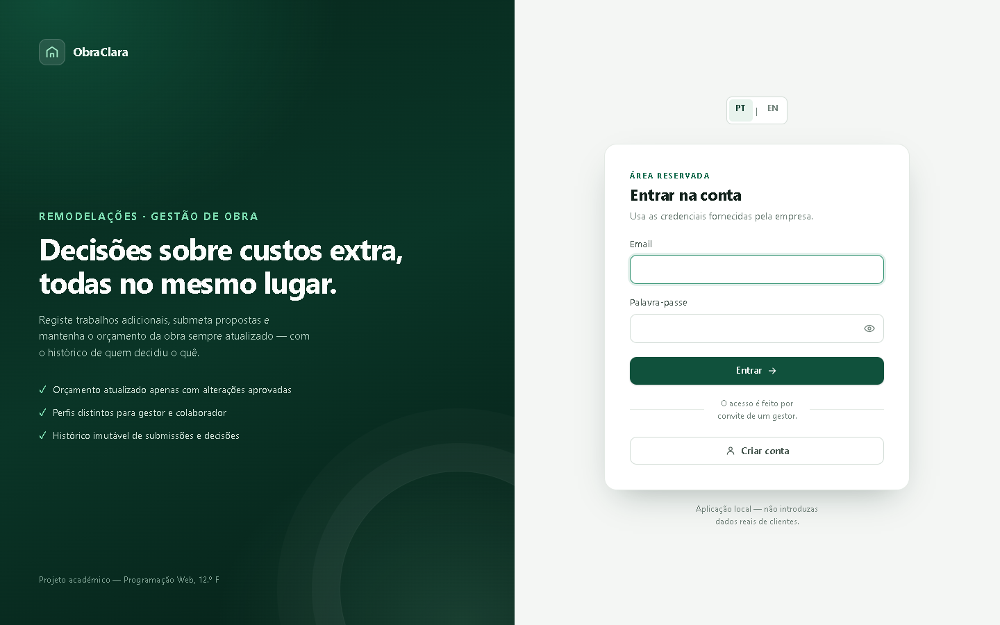

Na página de entrada:

1. Preencher **Email** e **Palavra-passe**.
2. Clicar em **Entrar**.
3. A aplicação abre o **Painel**.

O ícone do olho mostra ou oculta a palavra-passe sem a alterar. O seletor **PT | EN** no
topo muda o idioma antes de entrar.

Contas fictícias de demonstração:

| Perfil | Email | Palavra-passe |
|---|---|---|
| Gestor | `gestor@obraclara.pt` | `Gestor2026!` |
| Colaborador | `colaborador@obraclara.pt` | `Colab2026!` |

Estas credenciais são apenas locais e fictícias. Não introduzir dados reais de clientes.

Se as credenciais estiverem erradas, aparece uma mensagem clara sem revelar qual dos
campos falhou. Após cinco tentativas falhadas na mesma sessão, o formulário bloqueia
temporariamente durante 60 segundos.

Para terminar a sessão, usar o botão **Sair** no cartão do utilizador, no fundo do menu
lateral. É um pedido POST protegido por CSRF, não um simples link. Em ecrãs pequenos, é
preciso abrir primeiro o menu (☰).

---

## 3. Criar uma conta por convite

A ObraClara é uma aplicação interna: não há registo livre. A conta nasce de um convite
criado por um gestor.

### 3.1 O gestor cria o convite

1. Abrir **Equipa** no menu lateral.
2. Escolher o separador **Convites**.
3. No cartão **Novo convite**, indicar:
   - **Email do novo utilizador**;
   - **Perfil atribuído** — colaborador ou gestor;
   - **Validade** — 1, 3, 7 ou 14 dias.
4. Clicar **Gerar convite**.
5. A aplicação mostra o link completo uma única vez. Clicar **Copiar** e entregá-lo à
   pessoa por um canal interno (não há envio automático de emails).
6. Se o convite se perder, criar outro. Um convite pendente pode ser revogado no separador
   **Convites**, com confirmação.

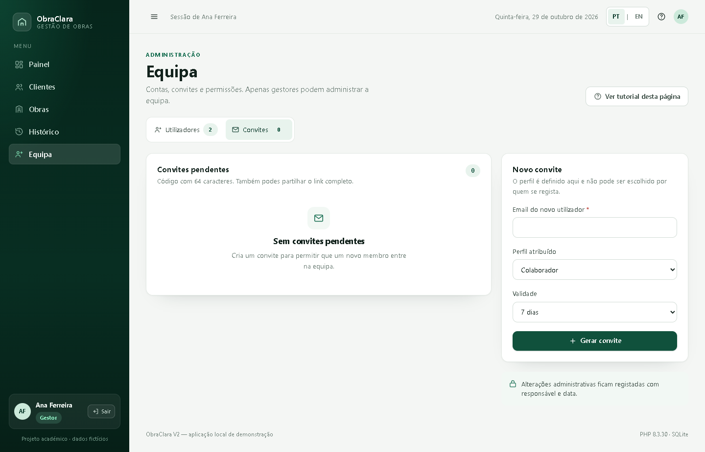

O perfil definido no convite não pode ser escolhido por quem se regista. Um convite
expirado, revogado ou já utilizado apresenta uma mensagem própria.

### 3.2 A nova pessoa cria a conta

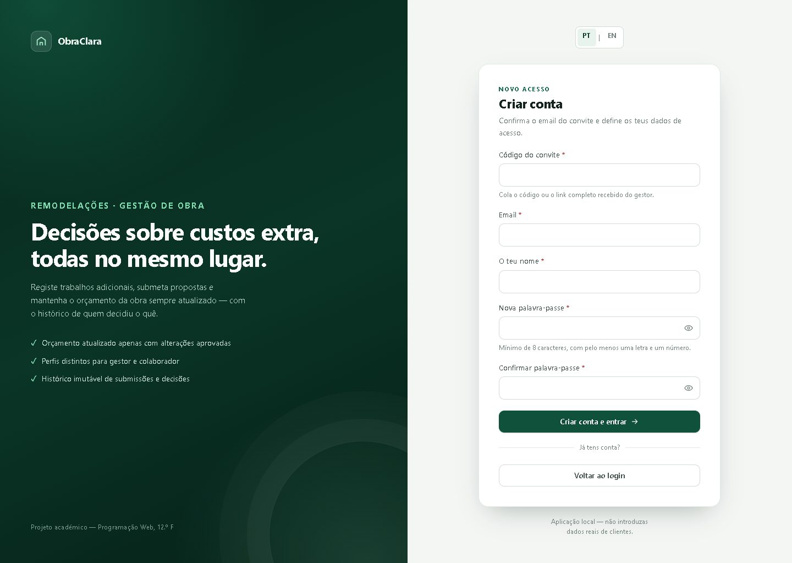

1. Abrir o link recebido, por exemplo
   `http://localhost:8000/registar?token=...`.
2. Confirmar o **Email** — tem de ser igual ao do convite.
3. Indicar o **Nome**.
4. Definir a **Nova palavra-passe** (mínimo 8 caracteres, com pelo menos uma letra e um
   número).
5. Repetir em **Confirmar palavra-passe**.
6. Clicar **Criar conta e entrar**.

Se o link não abrir diretamente, é possível colar o código ou o link completo no campo
**Código do convite**, na página **Criar conta**. Depois do registo, a sessão inicia
automaticamente e o tutorial de boas-vindas aparece.

### 3.3 Gestão de utilizadores

Em **Equipa → Utilizadores**, o gestor pode:

- pesquisar por nome ou email;
- abrir o perfil de cada conta;
- alterar o perfil entre gestor e colaborador;
- ativar ou desativar uma conta;
- consultar a data de criação e o estado.

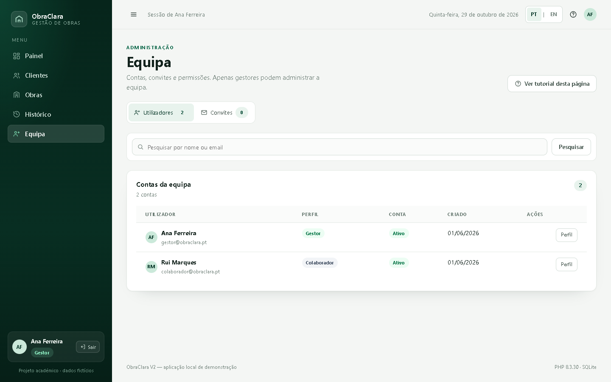

Proteções aplicadas pelo servidor:

- um gestor não desativa a própria conta;
- o último gestor ativo não pode ser desativado nem despromovido;
- um colaborador nunca acede a **Equipa** (recebe 403);
- uma conta desativada perde o acesso mesmo que ainda tenha uma sessão aberta.

As alterações administrativas ficam registadas com responsável, ação e data. Nunca são
guardadas palavras-passe nem tokens completos.

---

## 4. Tutorial interativo

Na primeira entrada aparece:

> **Bem-vindo à ObraClara!**
> Gostarias de conhecer as principais funcionalidades da aplicação?

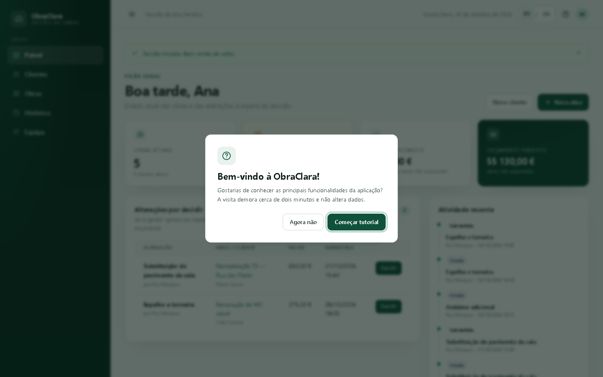

- **Começar tutorial** inicia a visita.
- **Agora não** fecha a visita; o tutorial deixa de aparecer automaticamente.

Durante a visita, o elemento explicado fica destacado e a caixa indica o progresso:

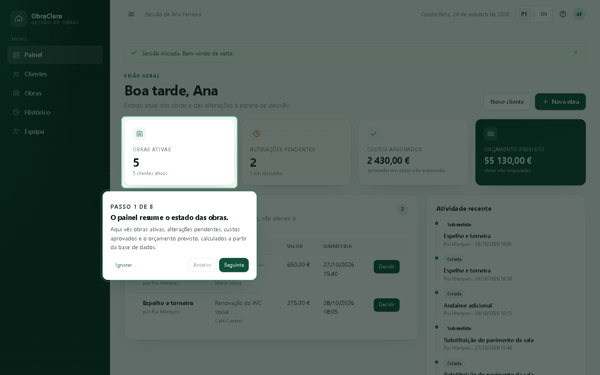

- **Seguinte** e **Anterior** navegam.
- **Ignorar** fecha.
- **Escape** fecha; as setas também navegam.
- O botão **?** no topo abre a visita contextual da página atual.
- Em **O meu perfil → Rever tutorial** é possível começar de novo.

Colaboradores não recebem instruções de gestão. O tutorial não altera dados e o progresso
fica guardado por conta.

---

## 5. Mudar de idioma

1. No topo da aplicação autenticada, clicar **PT** ou **EN**.
2. A página atual recarrega no idioma escolhido, sem terminar a sessão.
3. A preferência fica associada à conta e é aplicada no login seguinte.
4. Também é possível alterar em **O meu perfil → Preferências → Idioma da interface**.

A moldura legal e os dados introduzidos pelos utilizadores (nomes, descrições, notas) não
são traduzidos. Os valores continuam em euros e são formatados segundo o idioma.

---

## 6. Painel

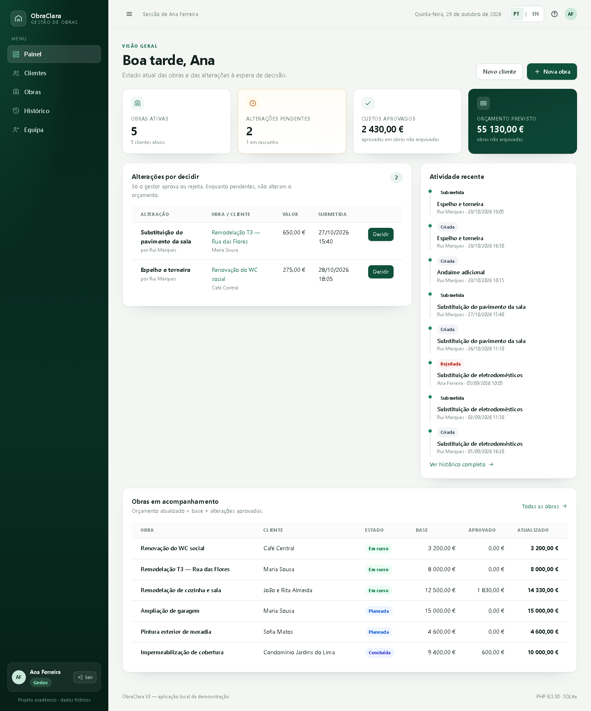

O painel apresenta quatro indicadores calculados a partir da base de dados:

- **Obras ativas** — obras planeadas ou em curso.
- **Alterações pendentes** — propostas submetidas que aguardam decisão.
- **Custos aprovados** — soma das alterações aprovadas em obras não arquivadas.
- **Orçamento previsto** — soma dos orçamentos atualizados das obras não arquivadas.

Abaixo encontram-se:

- **Alterações por decidir** — o gestor vê o botão **Decidir**; o colaborador vê
  “Aguarda gestor”.
- **Atividade recente** — últimos eventos do histórico.
- **Obras em acompanhamento** — base, custos aprovados e total atualizado de cada obra.

O menu lateral dá acesso a **Painel**, **Clientes**, **Obras**, **Histórico** e, para
gestores, **Equipa**. Em ecrãs pequenos, o botão ☰ abre e fecha a navegação.

---

## 7. Clientes

### 7.1 Consultar e pesquisar

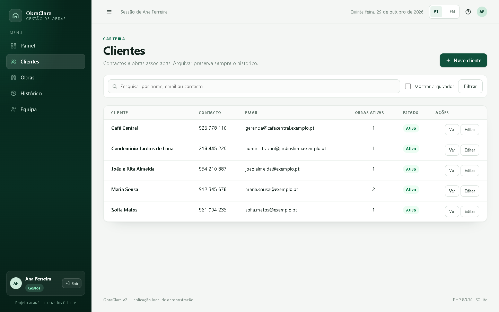

1. Abrir **Clientes** no menu.
2. Escrever parte do nome, email ou contacto e clicar **Filtrar**.
3. Ativar **Mostrar arquivados** para incluir clientes fora da carteira ativa.
4. Clicar no nome do cliente para abrir o detalhe.

Se a pesquisa não tiver resultados, a aplicação explica-o e oferece **Limpar pesquisa**,
em vez de mostrar uma tabela vazia sem contexto.

### 7.2 Criar um cliente

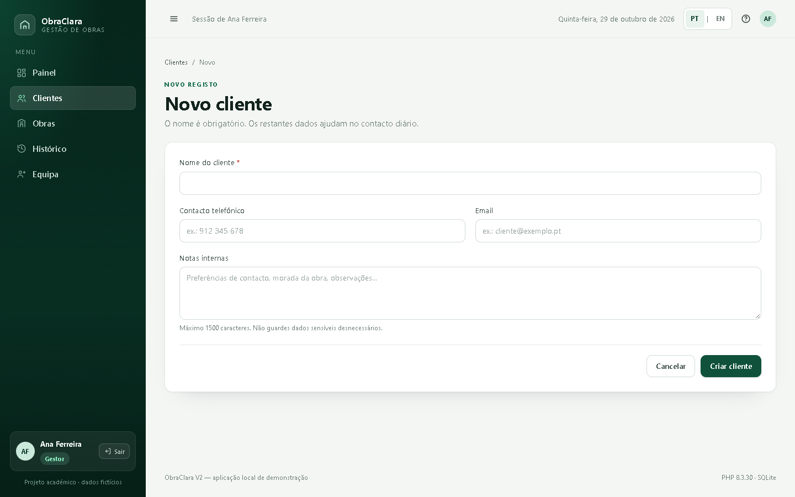

1. Clicar **Novo cliente**.
2. Preencher o **Nome** (obrigatório, 2–120 caracteres).
3. Opcionalmente, indicar **Contacto telefónico**, **Email** e **Notas internas**.
4. Clicar **Criar cliente**.

O email é validado no servidor. Se houver erros, o formulário é reapresentado com a
mensagem junto ao campo e com os restantes dados preenchidos.

### 7.3 Editar e arquivar

- **Editar** abre o mesmo formulário com os dados atuais.
- **Arquivar** pede confirmação e só é permitido se o cliente não tiver obras ativas.
  O histórico e as obras mantêm-se; o cliente deixa de poder receber novas obras.
- **Reativar cliente** volta a colocá-lo disponível para novas obras.

Nenhum cliente é apagado definitivamente.

---

## 8. Obras

### 8.1 Lista e filtros

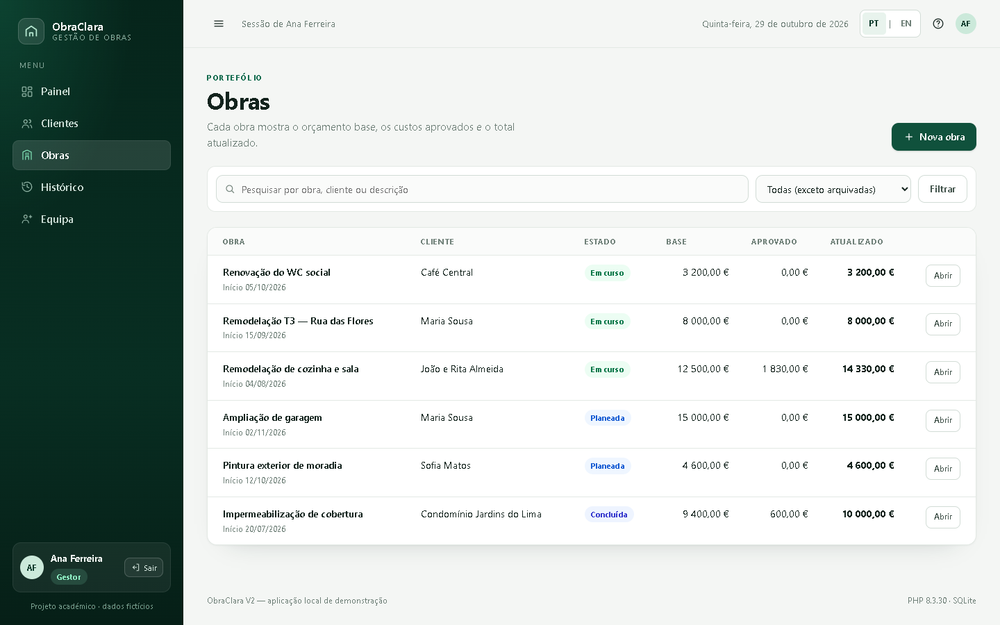

Em **Obras** é possível:

- pesquisar por título, cliente ou descrição;
- filtrar por **Planeadas**, **Em curso**, **Concluídas** ou **Arquivadas**;
- comparar **Base**, **Aprovado** e **Atualizado** na mesma linha.

### 8.2 Criar uma obra (gestor)

1. Clicar **Nova obra**.
2. Escolher o **Cliente** (apenas clientes ativos).
3. Indicar o **Título** e o **Orçamento base** em euros — por exemplo `8 000,00`.
4. Opcionalmente, indicar data de início, estado e descrição do âmbito.
5. Clicar **Criar obra**.

O campo de dinheiro aceita `8000`, `8000,00`, `8.000,00` ou `8000.00`. Valores negativos,
texto, mais de duas casas decimais ou valores acima de 99 999 999,99 € são recusados.
Internamente o valor é guardado em cêntimos inteiros.

### 8.3 Detalhe da obra

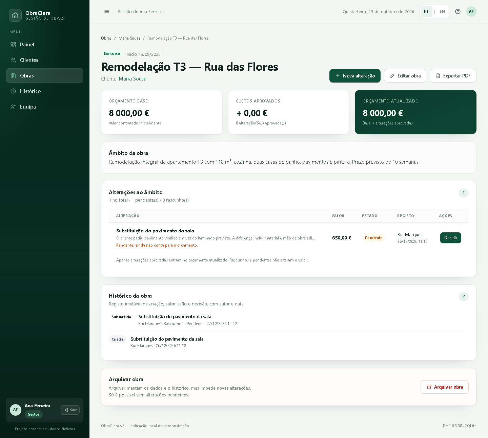

O detalhe mostra:

- estado da obra, cliente e data de início;
- **Orçamento base**, **Custos aprovados** e **Orçamento atualizado**;
- âmbito da obra;
- tabela de alterações com valor, estado, autor e datas;
- histórico de eventos da obra;
- ações **Nova alteração**, **Editar obra**, **Exportar PDF** e arquivar/reativar.

O orçamento atualizado é sempre **base + soma das alterações aprovadas**. Rascunhos,
pendentes e rejeitadas não alteram o valor. A própria página explica esta regra.

---

## 9. Alterações ao âmbito

### 9.1 Criar uma alteração

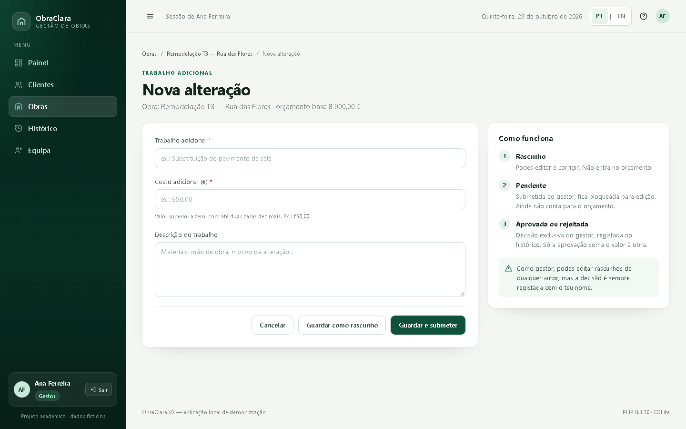

1. Na obra, clicar **Nova alteração**.
2. Indicar o **Trabalho adicional** (obrigatório).
3. Indicar o **Custo adicional** em euros (obrigatório, superior a zero).
4. Descrever o trabalho, se necessário.
5. Escolher:
   - **Guardar como rascunho** — fica editável e não conta para o orçamento;
   - **Guardar e submeter** — passa imediatamente a pendente.
6. Depois de guardar, a página volta à obra com a confirmação.

### 9.2 Ciclo de vida

| Estado | Quem pode | Efeito no orçamento |
|---|---|---|
| **Rascunho** | Autor ou gestor edita; qualquer utilizador autenticado pode criar | Não conta |
| **Pendente** | Já não é editável; aguarda decisão do gestor | Não conta |
| **Aprovada** | Decisão final do gestor | Soma o valor à obra |
| **Rejeitada** | Decisão final do gestor, com motivo | Não altera a obra |

Um rascunho pode ser submetido com o botão **Submeter**, que pede confirmação. Depois
disso, a alteração fica bloqueada para edição.

### 9.3 Decidir (apenas gestor)

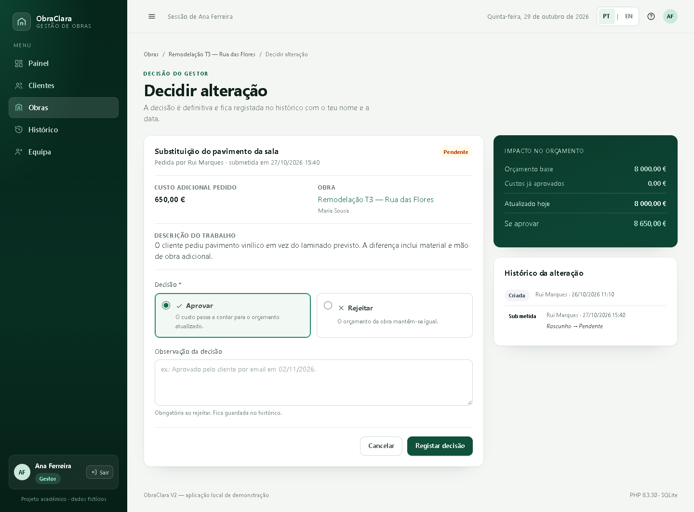

1. Abrir a alteração pendente através de **Decidir** (painel ou obra).
2. Confirmar os dados e o impacto apresentado na coluna lateral
   (**Atualizado hoje** vs. **Se aprovar**).
3. Escolher **Aprovar** ou **Rejeitar**.
4. Escrever uma observação. É obrigatória ao rejeitar e fica guardada no histórico.
5. Clicar **Registar decisão**.

A decisão é definitiva e registada com o nome do gestor e a data/hora. Não é possível
decidir duas vezes, editar uma alteração decidida ou alterar diretamente o valor na base
de dados (trigger de proteção).

Se um colaborador tentar aprovar por um pedido direto ao servidor, recebe
**403 — Sem permissão**, mesmo que consiga construir o pedido manualmente.

### 9.4 Resultado da aprovação

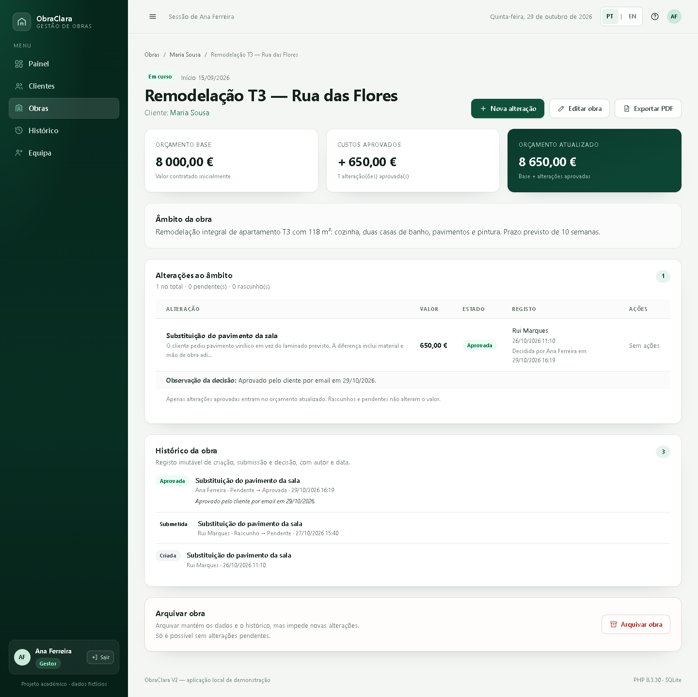

Depois de aprovar os 650 €, a obra passa a mostrar:

- base **8 000,00 €**;
- custos aprovados **+ 650,00 €**;
- orçamento atualizado **8 650,00 €**;
- decisão e observação no histórico, com autor e data.

> Para repetir a demonstração original, executar `php scripts/seed.php --reset`,
> que repõe a alteração de 650 € como pendente e o orçamento em 8 000 €.

---

## 10. Histórico

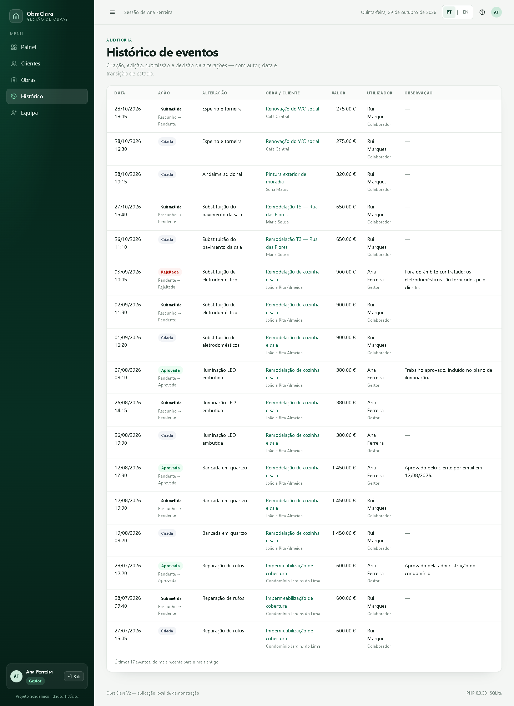

Em **Histórico** aparecem os últimos 100 eventos, do mais recente para o mais antigo:

- data e hora;
- ação (criada, editada, submetida, aprovada, rejeitada);
- transição de estado;
- alteração, obra e cliente;
- valor;
- utilizador e perfil;
- observação, quando existe.

O histórico é apenas de inserção: não há ecrã para editar ou apagar eventos, e a base de
dados recusa `UPDATE`/`DELETE` nessa tabela.

---

## 11. Exportar uma obra em PDF

1. Abrir a obra.
2. Clicar **Exportar PDF**, junto às ações principais.
3. O browser descarrega `ObraClara-obra-1.pdf`.
4. Abrir o documento para confirmar cliente, estado, orçamentos, alterações e decisões.

O PDF é gerado localmente, sem internet nem serviços externos. Inclui a identidade
ObraClara, a data de geração, o total aprovado e o orçamento atualizado. Também declara
que é um documento informativo de gestão: **não é fatura certificada, contrato assinado
nem prova legal de aceitação**.

O documento respeita o idioma ativo da sessão. Se estiver em inglês, os rótulos e a
formatação monetária acompanham; os nomes e descrições introduzidos pelos utilizadores
mantêm-se como foram escritos.

---

## 12. O meu perfil

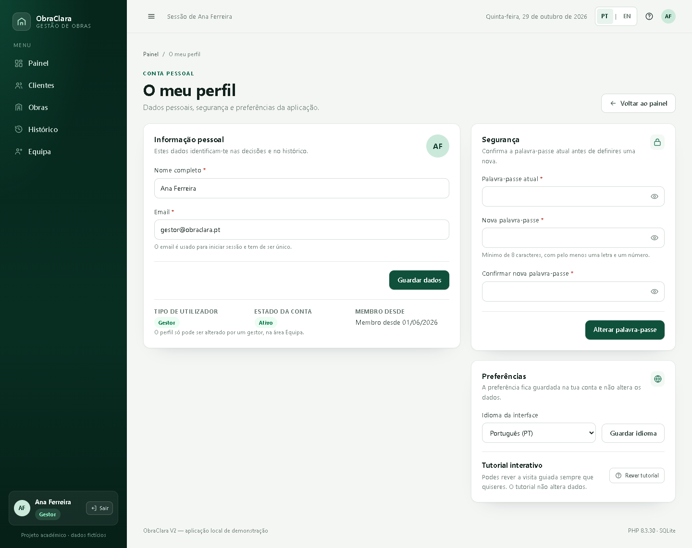

Abrir pelo avatar/nome no canto inferior do menu ou pelo avatar no topo.

### 12.1 Alterar dados pessoais

1. Alterar **Nome completo** e/ou **Email**.
2. Clicar **Guardar dados**.
3. A aplicação confirma a gravação.

O email tem de ser válido e único; maiúsculas e minúsculas não criam duplicados. O perfil
e o estado da conta não podem ser alterados nesta página — só um gestor o faz em
**Equipa**.

### 12.2 Alterar a palavra-passe

1. Em **Segurança**, indicar a **Palavra-passe atual**.
2. Definir a **Nova palavra-passe** (mínimo 8 caracteres, letra e número).
3. Repetir em **Confirmar nova palavra-passe**.
4. Clicar **Alterar palavra-passe**.

A palavra-passe atual nunca é mostrada. O ícone do olho permite mostrar/ocultar os campos
novos. Após a alteração, a sessão é renovada e o token CSRF é rodado. Se a palavra-passe
atual estiver errada, a operação não é feita.

### 12.3 Preferências

- **Idioma da interface** — guardar PT ou EN na conta.
- **Rever tutorial** — iniciar novamente a visita guiada.

---

## 13. Diferentes perfis

| Ação | Gestor | Colaborador |
|---|---|---|
| Ver painel, clientes, obras e histórico | Sim | Sim |
| Criar/editar/arquivar clientes | Sim | Não (403) |
| Criar/editar/arquivar obras | Sim | Não (403) |
| Criar alterações e submeter | Sim | Sim |
| Editar rascunhos de outros autores | Sim | Não (só os próprios) |
| Aprovar ou rejeitar | Sim | Não (403) |
| Gerir equipa, convites e perfis | Sim | Não (403) |
| Exportar PDF | Sim | Sim |
| Alterar o próprio perfil e palavra-passe | Sim | Sim |

A interface esconde ações sem permissão, mas a decisão é sempre revalidada no servidor.

---

## 14. Utilizar no telemóvel

A aplicação é uma web app responsiva; não é necessário instalar nada.

1. No telemóvel, abrir o endereço do computador na mesma rede Wi-Fi, por exemplo
   `http://172.16.58.199/` (ou o IP mostrado por `ipconfig`).
2. Tocar em ☰ para abrir o menu.
3. Usar os cartões em vez de tabelas; os valores e botões ficam empilhados.
4. O seletor **PT | EN** e o botão **?** continuam no topo.
5. O tutorial adapta-se ao ecrã e não bloqueia a interface depois de fechado.

Em ecrãs pequenos, o botão **Sair** está dentro do menu lateral. Se o endereço não abrir,
confirmar que o telemóvel não está numa rede de convidados e que o Windows permite o
servidor na firewall.

---

## 15. Arquivo em vez de eliminação

- **Cliente** só pode ser arquivado sem obras ativas.
- **Obra** só pode ser arquivada sem alterações pendentes.
- **Conta** é desativada, não apagada; o histórico mantém o autor.
- Obra arquivada não aceita novas alterações nem decisões; pode ser reativada.
- Nada é apagado, preservando a leitura do histórico e dos valores.

---

## 16. Mensagens e resolução de problemas

| Situação | O que fazer |
|---|---|
| “Credenciais inválidas” | Confirmar email e palavra-passe; atenção a maiúsculas e ao `!` final. |
| “Demasiadas tentativas” | Aguardar 60 segundos e tentar de novo. |
| “A sua sessão expirou” | Voltar a entrar; a sessão terminou por inatividade ou reinício. |
| “Sessão expirada” ao guardar | A página esteve aberta demasiado tempo; recarregar e repetir. |
| “Convite inválido” | Confirmar o link completo; pode ter sido mal copiado. |
| “Convite expirado/revogado” | Pedir um novo convite ao gestor. |
| “Convite já utilizado” | Cada convite só cria uma conta; pedir outro. |
| “Email não corresponde ao convite” | Usar exatamente o email indicado pelo gestor. |
| “Apenas o gestor pode aprovar” | Entrar com a conta de gestor. |
| “Último gestor ativo” | Promover outro gestor antes de alterar/desativar este. |
| “Não pode desativar a própria conta” | Pedir a outro gestor que faça a alteração. |
| “Só alterações pendentes podem ser decididas” | A alteração já foi decidida; consultar o histórico. |
| “Obra está arquivada” | Reativar a obra antes de criar ou decidir alterações. |
| “Cliente tem obras ativas” | Arquivar ou concluir primeiro as obras. |
| “Sem resultados” | Limpar a pesquisa ou o filtro de estado. |
| Porta 8000 ocupada | Usar outra porta: `php -S localhost:8080 -t public public/router.php`. |
| Base de dados em falta | Executar `php scripts/install.php` e `php scripts/seed.php --reset`. |
| `pdo_sqlite` em falta | Ativar a extensão no `php.ini` do Laragon e reiniciar o servidor. |
| Ecrã estranho após atualização | Recarregar com `Ctrl+F5` para limpar CSS antigo. |
| PDF não descarrega | Confirmar que a sessão continua ativa e que a obra existe. |

Os detalhes técnicos dos erros ficam no log do servidor, nunca na página.

---

## 17. Repor os dados de demonstração

```bash
php scripts/seed.php --reset
```

O comando recria apenas `database/obraclara.sqlite` e volta a criar:

- 2 utilizadores fictícios;
- 6 clientes (um arquivado);
- 7 obras (uma arquivada);
- 7 alterações em todos os estados;
- 17 eventos de histórico.

**Atenção:** este comando apaga a base de demonstração local, incluindo contas criadas
por convite. Não deve ser executado sobre dados que se queiram conservar. Para atualizar
o esquema sem apagar dados, usar `php scripts/install.php`.

---

## 18. Boas práticas

- Não introduzir dados pessoais reais de clientes nesta instalação académica.
- Terminar a sessão ao sair de um computador partilhado.
- Não publicar a pasta `database/` nem o ficheiro `.sqlite`.
- Entregar convites por um canal interno e revogar os que não forem usados.
- Em ambiente real, servir sempre por HTTPS, fazer cópias de segurança e rever a
  retenção de dados.
