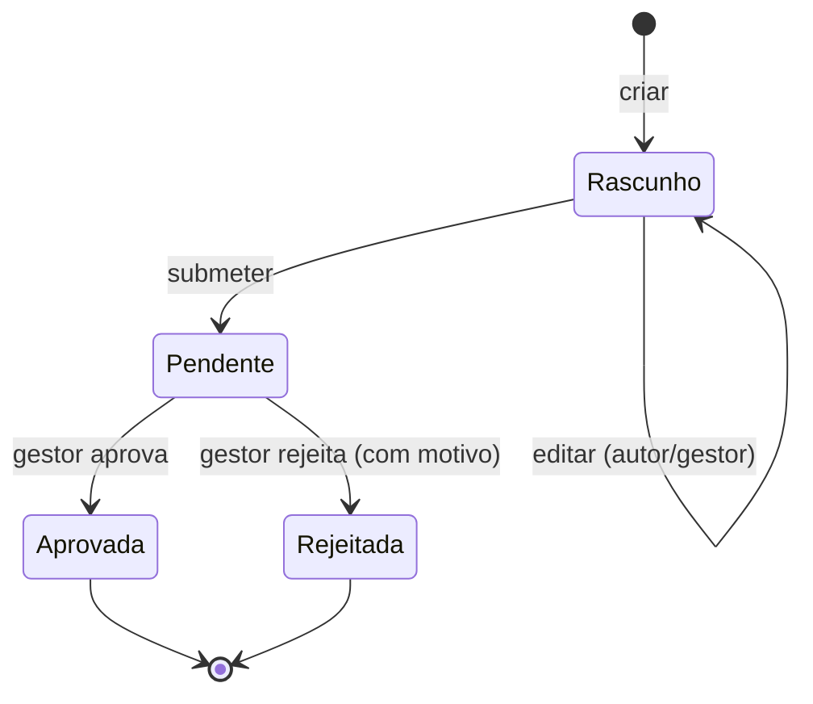

# Relatório do projeto — ObraClara V2

**Curso:** Programação Web · 12.º F · 2026/2027
**Projeto:** ObraClara V2 — gestão de alterações e custos extra em obras de remodelação
**Autor:** aluno do 12.º F (identificação na entrega do Moodle)
**Data:** 29 de outubro de 2026
**Repositório:** <https://github.com/Sashix09r/ObraClara/tree/ai/obraclara-v2>
**Aplicação:** local, em `http://localhost:8000` durante a demonstração

---

## 1. Resumo

A ObraClara V2 é uma aplicação web para uma empresa fictícia de remodelações. Resolve um
problema concreto do dia a dia: quando o cliente pede um trabalho adicional, é preciso
registar o pedido, saber quanto custa, obter uma decisão e manter o orçamento da obra
correto — sem perder o rasto de quem aprovou, quando e com que justificação.

A aplicação permite autenticar dois perfis (gestor e colaborador), gerir clientes e obras,
criar e submeter alterações, aprovar ou rejeitar (apenas o gestor), calcular o orçamento
atualizado apenas com alterações aprovadas e consultar um histórico imutável. Os dados
persistem em SQLite. A interface foi desenhada como um produto SaaS de gestão de obra,
com atenção à legibilidade, aos estados vazios, às mensagens de erro e ao comportamento
em ecrãs pequenos.

O cenário central foi implementado e testado: uma obra de **8 000,00 €** com uma alteração
de **650,00 €** pendente mantém 8 000,00 €; após aprovação do gestor passa a **8 650,00 €**,
com o decisor e a data no histórico. Uma tentativa de aprovação por um colaborador é
recusada pelo servidor com **403**.

---

## 2. Empresa, problema e utilizadores

### 2.1 A empresa

A ObraClara é uma microempresa fictícia de construção e remodelação de habitações e
pequenos espaços comerciais. Trabalha com vários clientes em simultâneo e executa obras
por empreitada, com um valor base contratado.

Durante a obra surgem pedidos que não estavam no âmbito inicial: mudar o pavimento,
substituir uma bancada, acrescentar iluminação, reparar um rufo. Cada pedido tem um custo
e precisa de uma decisão do cliente, transmitida internamente ao gestor. O problema não é
faturar: é **controlar o âmbito, o custo adicional e a decisão**, mantendo o orçamento
da obra rigoroso.

### 2.2 Problema identificado

Sem um sistema, a informação dispersa-se por mensagens, folhas de cálculo e memória:

- não é claro se um trabalho adicional foi aprovado ou apenas pedido;
- o orçamento inicial confunde-se com o valor atualizado;
- perde-se o registo de quem autorizou e quando;
- um colaborador pode assumir uma decisão que não lhe compete;
- valores em vírgula flutuante introduzem erros de cêntimos.

A aplicação responde a estes cinco pontos com um fluxo único e auditável.

### 2.3 Utilizadores

| Utilizador | Necessidades | Permissões |
|---|---|---|
| **Gestor** | Gerir carteira de clientes e obras, decidir custos extra, acompanhar indicadores | Tudo; aprova/rejeita |
| **Colaborador** | Consultar obras, propor trabalhos adicionais, corrigir rascunhos, submeter | Cria/edita os seus rascunhos e submete; não decide nem gere clientes/obras |
| **Cliente final** | Receber propostas e comunicar a decisão | Sem conta; a decisão é registada pelo gestor |

O cliente final não tem login no MVP, por decisão de âmbito: a aplicação é uma ferramenta
interna da empresa, não uma plataforma de assinatura ou pagamento.

---

## 3. Contexto do setor e fontes

A construção e a reabilitação em Portugal têm tido atividade elevada. Os dados oficiais
mais recentes disponíveis no início do projeto (INE, *Estatísticas da Construção e
Habitação 2024*) apontam para crescimento do licenciamento e das obras concluídas, com
aumento das licenças de reabilitação. A síntese divulgada indica 25 470 edifícios
licenciados (+7,2%) e 28 494 fogos concluídos (+6,8%) em 2024, valores que devem ser
confirmados na publicação original.

Independentemente do valor exato, a consequência para uma microempresa é direta: mais
obras em simultâneo, mais pedidos de alteração e mais necessidade de controlo
administrativo. As ferramentas genéricas de folha de cálculo não impõem estados,
permissões nem histórico; é aí que uma aplicação dedicada acrescenta valor.

**Fontes consultadas:**

- INE — *Estatísticas da Construção e Habitação 2024* (publicação oficial).
  <https://www.ine.pt/ngt_server/attachfileu.jsp?look_parentBoui=738029493&att_display=n&att_download=y>
- IMPIC — *Relatório do Setor da Construção em Portugal 2024*.
  <https://www.impic.pt/impic/assets/misc/relatorios_dados_estatisticos/Relatorio_Construcao_2024.pdf>
- Construção Magazine — síntese das estatísticas de 2024.
  <https://www.construcaomagazine.pt/noticias/estatisticas-da-construcao-e-habitacao-2024/>
- Forum das Cidades — resumo dos indicadores INE 2024.
  <https://www.forumdascidades.pt/content/estatisticas-da-construcao-e-habitacao-2024>

Não foram realizadas entrevistas nem inquéritos; o estudo do problema baseia-se na
observação do funcionamento típico de pequenas empresas de remodelação e nestas fontes
documentais. Essa limitação está assumida na secção 12.

---

## 4. Requisitos e âmbito

### Funcionais

1. Autenticação com sessão e dois perfis.
2. CRUD e arquivo de clientes, com pesquisa.
3. CRUD e arquivo de obras associadas a clientes, com orçamento base.
4. Alterações com estados rascunho, pendente, aprovada e rejeitada.
5. Submissão pelo colaborador; decisão exclusiva do gestor.
6. Orçamento atualizado = base + alterações aprovadas.
7. Histórico de criação, edição, submissão e decisão, com autor e data.
8. Pesquisa e filtros; dashboard com indicadores reais.
9. Dados fictícios de demonstração.

### Não funcional

- PHP 8.3, SQLite/PDO, HTML/CSS/JS, execução local em Windows/Laragon.
- Valores em cêntimos inteiros; output em pt-PT.
- Segurança: hashes de palavra-passe, CSRF, queries preparadas, escape de HTML,
  autorização no servidor, sessão segura.
- Interface responsiva, acessível por teclado, com feedback claro.
- Instalação reprodutível e testada, sem dependências pagas.

### Fora do âmbito

Faturação certificada, pagamentos, assinatura digital, notificações, uploads, login de
clientes, multiempresa, aplicação móvel nativa e integrações externas. Também não se
reutilizou código do protótipo anterior.

---

## 5. Tecnologias e justificação

| Tecnologia | Porquê |
|---|---|
| **PHP 8.3** | Linguagem estudada na disciplina, disponível no Laragon, adequada a páginas dinâmicas no servidor e a validação centralizada. |
| **SQLite + PDO** | Base relacional real, sem servidor de BD nem configuração pesada; PDO com *prepared statements* e transações. Fácil de transportar para a apresentação. |
| **HTML5 semântico** | Formulários acessíveis, tabelas com cabeçalhos, estados e mensagens com `role` adequado. |
| **CSS3** | Layout próprio com Grid/Flex, variáveis, media queries e identidade visual; sem framework. |
| **JavaScript mínimo** | Apenas menu móvel, confirmação de ações, destaque da decisão e fecho de mensagens. Nenhuma regra de negócio depende de JS. |
| **Sem Composer/framework** | Menos risco de instalação na escola, mais controlo sobre o código e melhor capacidade de explicar cada ficheiro. |

A base de dados fica fora de `public/`, a única pasta exposta pelo servidor. O autoload é
um `spl_autoload_register` de poucas linhas.

---

## 6. Arquitetura

```
public/index.php          front controller: cabeçalhos, sessão, CSRF, rotas, erros
app/Http/Controllers      recebem o pedido, validam permissões, orquestram serviços
app/Services              regras de negócio e validações de domínio
app/Repositories          SQL com PDO preparado
app/Support               Auth, sessão, CSRF, dinheiro, vistas, exceções, etiquetas
app/views                 layout e páginas
database/schema.sql       tabelas, índices, constraints e triggers
scripts/                  install e seed
tests/run.php             testes automatizados
```

O pedido percorre **controlador → serviço → repositório**. As regras críticas estão nos
serviços, dentro de transações: criar/submeter/decisar uma alteração grava a mudança de
estado e o evento de histórico na mesma transação. A interface não é a autoridade: esconder
um botão é apenas conveniência.

---

## 7. Base de dados

O modelo completo, com colunas e restrições, está em
[`docs/10_MODELO_RELACIONAL.md`](10_MODELO_RELACIONAL.md).

Tabelas: `users`, `clients`, `projects`, `changes`, `change_events`.

Relações principais:

- um cliente tem 0..N obras; cada obra pertence a 1 cliente;
- uma obra tem 0..N alterações; cada alteração pertence a 1 obra;
- cada alteração tem 0..N eventos; cada evento pertence a 1 utilizador;
- cada alteração tem um autor e pode ter um gestor decisor.

Decisões de modelação:

- **Cêntimos inteiros** em vez de `DECIMAL`/`float`, com `CHECK` de positividade e limite.
- **Arquivo lógico** (`active` em clientes; estado `arquivada` em obras), nunca eliminação.
- **Histórico separado** da alteração, para preservar todas as transições.
- **Constraints e triggers** como segunda linha de defesa: estados válidos, valores
  positivos, FK com `RESTRICT` e histórico imutável.
- **`PRAGMA foreign_keys = ON`** em todas as ligações.

---

## 8. Regras de negócio

### Orçamento

```
orçamento atualizado = orçamento base + Σ (alterações com estado "aprovada")
```

Rascunhos, pendentes e rejeitadas não somam. A soma é feita em SQL e em PHP com inteiros.
O teste de aceitação confirma 800 000 + 65 000 = 865 000 cêntimos (8 650,00 €).

### Estados



- Só rascunhos são editáveis; o autor ou o gestor podem fazê-lo.
- Submeter exige rascunho e obra não arquivada.
- Decidir exige perfil de gestor, estado pendente e obra não arquivada.
- Rejeitar exige observação com pelo menos 3 caracteres.
- Decisões finais são imutáveis (serviço + trigger na BD).

### Arquivo

- Cliente só é arquivado se não tiver obras ativas.
- Obra só é arquivada se não tiver alterações pendentes.
- Obra arquivada não aceita alterações nem decisões.
- Reativar uma obra coloca-a em “Planeada”.

---

## 9. Segurança

| Risco | Medida implementada |
|---|---|
| Palavras-passe | `password_hash`/`password_verify`; nunca texto simples; rehash automático. |
| Sequestro de sessão | Cookie `HttpOnly`, `SameSite=Lax`, `use_strict_mode`, regeneração do ID no login. |
| CSRF | Token por sessão em todos os POST, verificado no front controller; token rodado no login. |
| SQL Injection | PDO com *prepared statements* e parâmetros ligados; estados validados por lista. |
| XSS | `htmlspecialchars` em toda a saída (`e()`), incluindo atributos e mensagens. |
| Escalada de privilégios | `requireManager()` e verificação do perfil no serviço de decisão; HTTP 403. |
| Força bruta | Limite de 5 tentativas por sessão com bloqueio temporário de 60 s. |
| Exposição de erros | Página genérica 500; detalhes apenas no log do servidor. |
| Clickjacking / MIME | `X-Frame-Options: DENY`, `X-Content-Type-Options: nosniff`, CSP. |
| Cache de dados privados | `Cache-Control: no-store`. |
| Valores monetários | Inteiros com limite e `CHECK` na base de dados. |

Os testes HTTP confirmaram: pedido direto do colaborador a `/alteracoes/1/decidir` devolve
403; formulário sem token devolve 419; logout sem token não termina a sessão; rota privada
sem sessão redireciona para o login.

---

## 10. Interface e decisões de UX

O objetivo foi que um utilizador abrisse a aplicação e percebesse, sem explicação, onde
está e o que pode fazer.


Decisões principais:

- **Menu lateral fixo** com quatro áreas (Painel, Clientes, Obras, Histórico) e cartão do
  utilizador com perfil e saída; em ecrãs pequenos passa a menu deslizante.
- **Verde-escuro e neutros** para transmitir solidez e ligação ao setor, com contraste
  suficiente e sem depender apenas da cor: os estados têm sempre texto (“Pendente”,
  “Aprovada”).
- **Orçamento em três cartões** (base, aprovado, atualizado), com o total destacado a
  verde-escuro. É a informação mais importante da obra.
- **Cenário visível na própria página**: “Pendente: ainda não conta para o orçamento.”
- **Decisão com impacto explícito**: antes de aprovar, o gestor vê “Atualizado hoje” e
  “Se aprovar”.
- **Feedback em todos os fluxos**: mensagens de sucesso, erros por campo, confirmações
  para submeter/arquivar, estados vazios com ação seguinte, pesquisa sem resultados.
- **Formulários com labels, obrigatórios assinalados, ajuda no formato do dinheiro** e
  valores antigos preservados quando há erro.
- **Tabelas responsivas**: em ecrãs pequenos transformam-se em cartões com rótulos,
  evitando deslocamento horizontal.
- **Acessibilidade**: `skip-link`, foco visível, `aria-invalid`/`aria-describedby`,
  botões com nome acessível, navegação por teclado.


As capturas foram obtidas da aplicação real. O manual em
[`docs/MANUAL_UTILIZACAO.md`](MANUAL_UTILIZACAO.md) usa as mesmas imagens.

### Melhorias feitas depois de observar a interface

- O cartão de decisão tinha o *radio* sobreposto à descrição; foi substituído por uma
  grelha de duas colunas.
- A coluna do dashboard esticava até à altura da atividade recente; a grelha passou a
  alinhar os cartões ao topo.
- A 390 px, uma nota longa numa célula criava overflow; as células passaram a quebrar
  linha e a medir `scrollWidth` igual ao viewport.
- A data do cabeçalho estava capitalizada palavra a palavra; passou a “Quinta-feira, 29 de
  outubro de 2026”.

---

## 11. Testes e resultados

Foram usados dois níveis:

1. **25 testes automatizados** (`php tests/run.php`), cada um com base SQLite descartável.
2. **Testes HTTP reais** com `curl` no servidor integrado.

Resultado final: **25/25 testes automatizados passaram**, código de saída 0. Evidência
completa, comandos e limitações em [`docs/RESULTADOS_TESTES.md`](RESULTADOS_TESTES.md).

Cobertura relevante:

- valores `650`, `650,00`, `650.00`, `8 000,00`, `1.234,56`, `1,234.56`; recusa de
  negativos, texto, três casas decimais e overflow;
- cenário 8 000 + 650 = 8 650, com histórico de 3 eventos e decisor correto;
- rejeição mantém o orçamento e exige motivo;
- várias aprovações somam 1 000,50 € e atualizam para 9 000,50 €;
- colaborador não decide; outro colaborador não edita rascunho alheio;
- decisão dupla, edição de aprovada e submissão de decidida são bloqueadas;
- trigger impede `UPDATE` direto a alteração decidida e `UPDATE`/`DELETE` ao histórico;
- FK e `CHECK` recusam órfãos e valores negativos;
- persistência após fechar e reabrir a ligação;
- dashboard com contagens e orçamento previsto reais;
- acentuação portuguesa preservada.

Testes HTTP confirmaram ainda: login inválido 401, CSRF 419, colaborador 403, obra
inexistente 404, validação 422, aprovação 302 e orçamento 8 650 € na página.

A aplicação foi também servida pelo **Apache 2.4.66 do Laragon**, com um Virtual Host
próprio e raiz em `public/`: 15/15 verificações passaram, pelo nome e pelo IP da rede
local, incluindo login, permissões, decisão, histórico e bloqueio de código interno.

**O que não foi testado:** telemóvel físico, Firefox/Safari, leitor de ecrã, teste de
usabilidade com um colega e carga concorrente. O telemóvel está registado como NÃO
EXECUTADO porque o agente não tem dispositivo; o URL e os passos ficam prontos em
`RESULTADOS_TESTES.md`.

---

## 12. Uso de IA

O projeto foi desenvolvido com assistência de IA, conforme permitido pelo enunciado, mas
com uma situação a esclarecer.

- **Ferramenta usada nesta implementação:** Freebuff Desktop, agente **Buffy**, em sessão
  de 29/10/2026. O nome do modelo subjacente não é apresentado na interface, pelo que não
  é inventado neste relatório. A sessão foi disponibilizada ao utilizador; a confirmação
  de que não houve cobrança deve ser feita na conta Freebuff.
- **Tarefas apoiadas:** estrutura do projeto, esquema SQL, serviços e controladores,
  interface CSS, scripts de instalação/seed, testes automatizados, revisão de segurança
  e redação da documentação.
- **Verificação humana/real:** o agente executou `php -l` em todos os ficheiros, a suíte de
  25 testes, testes HTTP com `curl`, servidor local e capturas reais. O aluno deve
  compreender e conseguir explicar o código e as decisões.
- **Histórico a esclarecer:** existe um protótipo anterior com assistência paga e o
  planeamento inicial foi preparado numa conversa com ChatGPT Plus, conforme
  [`docs/REGISTO_IA.md`](REGISTO_IA.md). Estes factos não são apresentados como IA
  exclusivamente gratuita. É necessário esclarecer com o professor se a restrição abrange
  também o planeamento e, se for caso disso, refazer essa parte com ferramentas gratuitas.
  Nenhum código do protótipo anterior foi copiado.

O registo detalhado, sem invenções, está em [`docs/REGISTO_IA.md`](REGISTO_IA.md).

---

## 13. Dificuldades e soluções

1. **Dinheiro com vírgula e ponto.** A primeira versão tratava sempre a vírgula como
   decimal, o que impedia `1,234.56`. A regra passou a usar o último separador como
   decimal quando existem ambos; os testes T01/T02 fixaram o comportamento.
2. **CSRF no login.** O token era rodado no login, mas o primeiro teste HTTP reutilizou o
   token antigo e recebeu 419. Em vez de enfraquecer a proteção, o teste foi corrigido —
   o comportamento é o desejado.
3. **Imutabilidade do histórico.** A regra estava só no serviço. Foram acrescentados
   triggers para impedir alterações diretas à BD e o teste T17 passou a exercitá-los.
4. **`seed.php --reset` no Windows.** O ficheiro SQLite ficava bloqueado porque a ligação
   PDO ainda era referenciada; foi libertada antes do `unlink`.
5. **Tabelas e cartões em ecrãs pequenos.** Foram precisos `flex-wrap` e quebra de texto
   para eliminar overflow; a verificação usou a largura real do documento.
6. **Capturas sem fabricar.** A janela do navegador integrado não estava visível para
   captura; as imagens foram geradas a partir da aplicação real com Chrome headless e uma
   sessão autenticada, sem maquetas.

---

## 14. Limitações e melhorias futuras

**Limitações atuais**

- Aplicação local, não publicada; sem HTTPS nem gestão de produção.
- SQLite adequado a uma empresa e poucos utilizadores; não é multiempresa.
- Sem notificações por email, anexos ou assinatura do cliente.
- Sem autenticação de dois fatores; bloqueio de tentativas apenas por sessão.
- Sem auditoria de leitura nem cópias de segurança automáticas.
- Testes de acessibilidade e usabilidade ainda incompletos.

**Melhorias possíveis**

- Confirmação da decisão pelo cliente através de link assinado (sem conta).
- Exportação de proposta/orçamento em PDF.
- Notificações internas de alterações pendentes.
- Relatórios por período, cliente e estado.
- Autenticação de dois fatores e gestão de utilizadores pela interface.
- Testes com PHPUnit e testes end-to-end com navegador.

---

## 15. Conclusão

A ObraClara V2 cumpre o cenário central e os requisitos P0/P1 definidos: autenticação com
perfis reais, clientes, obras, alterações com estados, decisão exclusiva do gestor,
orçamento exato em cêntimos, histórico auditável, dashboard com dados SQL e interface
responsiva. O código está organizado por responsabilidades, tem validação no servidor e
25 testes automatizados executados, além de testes HTTP reais.

O projeto também tornou visível o que ainda falta: teste num telemóvel físico, testes com
utilizadores reais e o esclarecimento académico sobre assistência de IA anterior.
Esses pontos estão assumidos, não escondidos, e têm próximos passos concretos.

---

## 16. Referências

1. INE — *Estatísticas da Construção e Habitação 2024*.
   <https://www.ine.pt/ngt_server/attachfileu.jsp?look_parentBoui=738029493&att_display=n&att_download=y>
2. IMPIC — *Relatório do Setor da Construção em Portugal 2024*.
   <https://www.impic.pt/impic/assets/misc/relatorios_dados_estatisticos/Relatorio_Construcao_2024.pdf>
3. Construção Magazine — síntese das estatísticas INE 2024.
   <https://www.construcaomagazine.pt/noticias/estatisticas-da-construcao-e-habitacao-2024/>
4. PHP Manual — PDO e *prepared statements*.
   <https://www.php.net/manual/en/pdo.prepared-statements.php>
5. PHP Manual — `password_hash`.
   <https://www.php.net/manual/en/function.password-hash.php>
6. SQLite — *Foreign Key Support*.
   <https://www.sqlite.org/foreignkeys.html>
7. OWASP — *Cross-Site Request Forgery Prevention Cheat Sheet*.
   <https://cheatsheetseries.owasp.org/cheatsheets/Cross-Site_Request_Forgery_Prevention_Cheat_Sheet.html>
8. OWASP — *Cross Site Scripting Prevention Cheat Sheet*.
   <https://cheatsheetseries.owasp.org/cheatsheets/Cross_Site_Scripting_Prevention_Cheat_Sheet.html>
9. W3C — *WCAG 2.2 Quick Reference*.
   <https://www.w3.org/WAI/WCAG22/quickref/>
10. MDN — *Learn HTML: Forms*.
    <https://developer.mozilla.org/en-US/docs/Learn/Forms>
