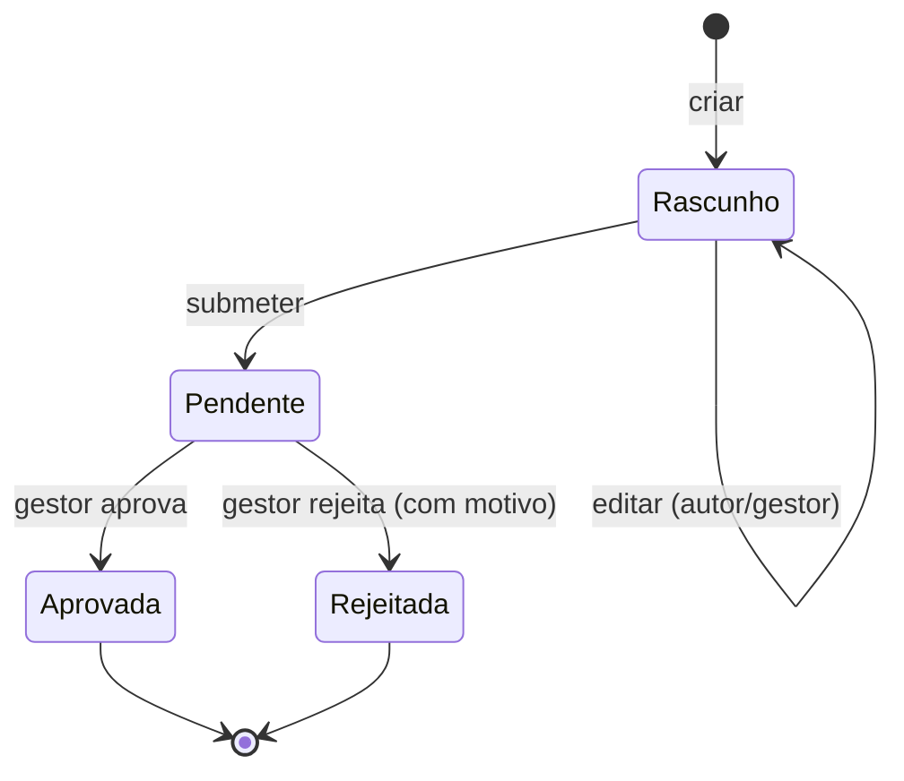
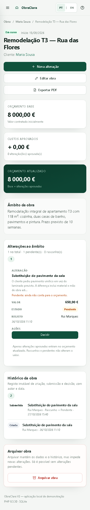

# Relatório do projeto — ObraClara V2

**Curso:** Programação Web · 12.º F · 2026/2027
**Projeto:** ObraClara V2 — gestão de alterações e custos extra em obras de remodelação
**Autor:** aluno do 12.º F (identificação na entrega do Moodle)
**Data:** 29 de outubro de 2026
**Repositório:** <https://github.com/Sashix09r/ObraClara/tree/ai/obraclara-v2>
**Aplicação:** local, em `http://localhost:8000` durante a demonstração

---

## 1. Resumo

A ObraClara V2 é uma aplicação web para uma empresa fictícia de remodelações. Resolve um
problema concreto do dia a dia: quando o cliente pede um trabalho adicional, é preciso
registar o pedido, saber quanto custa, obter uma decisão e manter o orçamento da obra
correto — sem perder o rasto de quem aprovou, quando e com que justificação.

A aplicação permite autenticar dois perfis (gestor e colaborador), gerir clientes e obras,
criar e submeter alterações, aprovar ou rejeitar (apenas o gestor), calcular o orçamento
atualizado apenas com alterações aprovadas e consultar um histórico imutável. A versão
final acrescenta um sistema de **contas por convite**, **gestão de equipa**, **perfil
pessoal**, **exportação PDF**, **tutorial interativo**, **interface PT/EN** e **layout
responsivo**. Os dados persistem em SQLite, com migrações incrementais.

O cenário central foi implementado e testado: uma obra de **8 000,00 €** com uma alteração
de **650,00 €** pendente mantém 8 000,00 €; após aprovação do gestor passa a **8 650,00 €**,
com o decisor e a data no histórico. Uma tentativa de aprovação por um colaborador é
recusada pelo servidor com **403**.

A suíte final tem **38 testes automatizados**, todos executados com sucesso, e um percurso
HTTP de **37 verificações** numa base descartável. A aplicação foi também servida pelo
Apache do Laragon num Virtual Host próprio.

---

## 2. Empresa, problema e utilizadores

### 2.1 A empresa

A ObraClara é uma microempresa fictícia de construção e remodelação de habitações e
pequenos espaços comerciais. Trabalha com vários clientes em simultâneo e executa obras
por empreitada, com um valor base contratado.

Durante a obra surgem pedidos que não estavam no âmbito inicial: mudar o pavimento,
substituir uma bancada, acrescentar iluminação, reparar um rufo. Cada pedido tem um custo
e precisa de uma decisão do cliente, transmitida internamente ao gestor. O problema não é
faturar: é **controlar o âmbito, o custo adicional e a decisão**, mantendo o orçamento
da obra rigoroso.

### 2.2 Problema identificado

Sem um sistema, a informação dispersa-se por mensagens, folhas de cálculo e memória:

- não é claro se um trabalho adicional foi aprovado ou apenas pedido;
- o orçamento inicial confunde-se com o valor atualizado;
- perde-se o registo de quem autorizou e quando;
- um colaborador pode assumir uma decisão que não lhe compete;
- valores em vírgula flutuante introduzem erros de cêntimos;
- a criação de contas e a gestão de acessos faz-se de forma informal.

A aplicação responde a estes pontos com um fluxo único, auditável e com contas controladas
pelo gestor.

### 2.3 Utilizadores

| Utilizador | Necessidades | Permissões |
|---|---|---|
| **Gestor** | Gerir carteira de clientes, obras, equipa e convites; decidir custos extra; consultar indicadores | Tudo; aprova/rejeita; administra utilizadores |
| **Colaborador** | Consultar obras, propor trabalhos adicionais, corrigir rascunhos, submeter | Cria/edita os seus rascunhos e submete; não decide nem gere clientes, obras ou equipa |
| **Cliente final** | Receber propostas e comunicar a decisão | Sem conta; a decisão é registada pelo gestor |

O cliente final não tem login no MVP, por decisão de âmbito: a aplicação é uma ferramenta
interna da empresa, não uma plataforma de assinatura ou pagamento.

---

## 3. Contexto do setor e fontes

A construção e a reabilitação em Portugal têm tido atividade elevada. Os dados oficiais
mais recentes disponíveis no início do projeto (INE, *Estatísticas da Construção e
Habitação 2024*) apontam para crescimento do licenciamento e das obras concluídas, com
aumento das licenças de reabilitação. A síntese divulgada indica 25 470 edifícios
licenciados (+7,2%) e 28 494 fogos concluídos (+6,8%) em 2024, valores que devem ser
confirmados na publicação original.

Independentemente do valor exato, a consequência para uma microempresa é direta: mais
obras em simultâneo, mais pedidos de alteração e mais necessidade de controlo
administrativo. As ferramentas genéricas de folha de cálculo não impõem estados,
permissões nem histórico; é aí que uma aplicação dedicada acrescenta valor.

**Fontes consultadas:**

- INE — *Estatísticas da Construção e Habitação 2024* (publicação oficial).
  <https://www.ine.pt/ngt_server/attachfileu.jsp?look_parentBoui=738029493&att_display=n&att_download=y>
- IMPIC — *Relatório do Setor da Construção em Portugal 2024*.
  <https://www.impic.pt/impic/assets/misc/relatorios_dados_estatisticos/Relatorio_Construcao_2024.pdf>
- Construção Magazine — síntese das estatísticas de 2024.
  <https://www.construcaomagazine.pt/noticias/estatisticas-da-construcao-e-habitacao-2024/>
- Forum das Cidades — resumo dos indicadores INE 2024.
  <https://www.forumdascidades.pt/content/estatisticas-da-construcao-e-habitacao-2024>

Não foram realizadas entrevistas nem inquéritos; o estudo do problema baseia-se na
observação do funcionamento típico de pequenas empresas de remodelação e nestas fontes
documentais. Essa limitação está assumida na secção 14.

---

## 4. Requisitos e âmbito

### Funcionais

1. Autenticação com sessão e dois perfis.
2. Criação de contas **apenas por convite**, com perfil e validade definidos pelo gestor.
3. Gestão de equipa: pesquisa, perfis, ativação/desativação, convites e auditoria.
4. Perfil pessoal com alteração de dados, palavra-passe e idioma.
5. CRUD e arquivo de clientes, com pesquisa.
6. CRUD e arquivo de obras associadas a clientes, com orçamento base.
7. Alterações com estados rascunho, pendente, aprovada e rejeitada.
8. Submissão pelo colaborador; decisão exclusiva do gestor.
9. Orçamento atualizado = base + alterações aprovadas.
10. Histórico de criação, edição, submissão e decisão, com autor e data.
11. Exportação PDF real do resumo de cada obra.
12. Tutorial interativo contextual, com estado por utilizador.
13. Interface em português europeu e inglês, com preferência persistente.
14. Pesquisa e filtros; dashboard com indicadores reais.
15. Dados fictícios de demonstração.

### Não funcional

- PHP 8.3, SQLite/PDO, HTML/CSS/JS, execução local em Windows/Laragon.
- Valores em cêntimos inteiros; output monetário correto em PT e EN.
- Segurança: hashes de palavra-passe, CSRF, queries preparadas, escape de HTML,
  autorização no servidor, sessão segura, convites de uso único.
- Interface responsiva, acessível por teclado, com feedback claro.
- Instalação reprodutível e testada, sem dependências pagas.

### Fora do âmbito

Faturação certificada, pagamentos, assinatura digital, envio de emails, notificações,
uploads, login de clientes, multiempresa, chat, IA em execução, integrações externas e
aplicação móvel nativa. Não se reutilizou código do protótipo anterior.

---

## 5. Tecnologias e justificação

| Tecnologia | Porquê |
|---|---|
| **PHP 8.3** | Linguagem estudada na disciplina, disponível no Laragon, adequada a páginas dinâmicas no servidor e a validação centralizada. |
| **SQLite + PDO** | Base relacional real, sem servidor de BD nem configuração pesada; PDO com *prepared statements* e transações. Fácil de transportar para a apresentação. |
| **HTML5 semântico** | Formulários acessíveis, tabelas com cabeçalhos, estados e mensagens com `role` adequado. |
| **CSS3** | Layout próprio com Grid/Flex, variáveis, media queries e identidade visual; sem framework. |
| **JavaScript mínimo** | Menu móvel, confirmação de ações, destaque da decisão, tutorial, copiar convite, mostrar palavra-passe. Nenhuma regra de negócio depende de JS. |
| **PDF próprio** | Gerador interno (`app/Support/Pdf.php`) com Helvetica/Windows-1252; evita bibliotecas externas e preserva acentos e o símbolo €. |
| **i18n própria** | Dois dicionários PHP e uma função `t()`; sem duplicar páginas nem espalhar condicionais. |

A base de dados fica fora de `public/`, a única pasta exposta pelo servidor. O autoload é
um `spl_autoload_register` de poucas linhas.

---

## 6. Arquitetura

```
public/index.php          front controller: cabeçalhos, sessão, CSRF, rotas, erros
app/Http/Controllers      recebem o pedido, validam permissões, orquestram serviços
app/Services              regras de negócio: contas, convites, alterações, PDF
app/Repositories          SQL com PDO preparado
app/Support               Auth, sessão, CSRF, dinheiro, i18n, migrações, PDF, vistas
app/views                 layout e páginas
database/schema.sql       tabelas, índices, constraints e triggers
scripts/                  install e seed
tests/run.php             testes automatizados
lang/                     dicionários PT e EN
```

O pedido percorre **controlador → serviço → repositório**. As regras críticas estão nos
serviços, dentro de transações: criar/submeter/decisar uma alteração grava a mudança de
estado e o evento de histórico na mesma transação; criar um convite grava o convite e o
registo administrativo na mesma transação. A interface não é a autoridade: esconder um
botão é apenas conveniência.

### Migrações

`app/Support/Migrator.php` mantém a tabela `schema_migrations` e aplica versões em falta
uma única vez. `scripts/install.php` cria uma cópia de segurança antes de migrar uma base
existente. Assim, uma instalação já usada é atualizada sem `seed.php --reset` e sem perder
dados. A migração 001 acrescenta preferências ao utilizador; a 002 cria convites,
auditoria e os índices associados.

---

## 7. Base de dados

O modelo completo está em [`docs/10_MODELO_RELACIONAL.md`](10_MODELO_RELACIONAL.md).

Tabelas: `users`, `clients`, `projects`, `changes`, `change_events`, `invites`,
`admin_events` e `schema_migrations`.

Relações principais:

- um cliente tem 0..N obras; cada obra pertence a 1 cliente;
- uma obra tem 0..N alterações; cada alteração pertence a 1 obra;
- cada alteração tem 0..N eventos; cada evento pertence a 1 utilizador;
- cada convite é criado por um gestor e pode ser usado por um único utilizador;
- cada evento administrativo tem um responsável e um alvo (utilizador ou convite).

Decisões de modelação:

- **Cêntimos inteiros** em vez de `DECIMAL`/`float`, com `CHECK` de positividade e limite.
- **Arquivo lógico** (`active` em clientes e utilizadores; estado `arquivada` em obras),
  nunca eliminação.
- **Histórico separado** da alteração, para preservar todas as transições.
- **Convites sem token em claro**: apenas `token_hash` SHA-256, uso único, expiração e
  revogação.
- **Auditoria administrativa** separada do histórico de obra, para não misturar conceitos.
- **Constraints e triggers** como segunda linha de defesa: estados válidos, valores
  positivos, FK com `RESTRICT` e histórico imutável.
- **`PRAGMA foreign_keys = ON`** em todas as ligações.

---

## 8. Regras de negócio

### Orçamento

```
orçamento atualizado = orçamento base + Σ (alterações com estado "aprovada")
```

Rascunhos, pendentes e rejeitadas não somam. A soma é feita em SQL e em PHP com inteiros.
O teste de aceitação confirma 800 000 + 65 000 = 865 000 cêntimos (8 650,00 €).

### Estados da alteração



- Só rascunhos são editáveis; o autor ou o gestor podem fazê-lo.
- Submeter exige rascunho e obra não arquivada.
- Decidir exige perfil de gestor, estado pendente e obra não arquivada.
- Rejeitar exige observação com pelo menos 3 caracteres.
- Decisões finais são imutáveis (serviço + trigger na BD).

### Contas e convites

- O registo público só é possível com um convite válido.
- O perfil (`gestor`/`colaborador`) vem do convite e é imutável no formulário; um campo
  manipulado não eleva privilégios.
- O token tem 64 caracteres hexadecimais (256 bits), é mostrado uma única vez e só o
  hash é guardado.
- Um convite só pode ser usado uma vez; expira no prazo definido (1, 3, 7 ou 14 dias).
- Um gestor pode revogar convites pendentes.
- O último gestor ativo não pode ser desativado nem despromovido.
- Um gestor não pode desativar a própria conta.
- Uma conta desativada não autentica, mesmo que exista um cookie de sessão antigo.

### Arquivo

- Cliente só é arquivado se não tiver obras ativas.
- Obra só é arquivada se não tiver alterações pendentes.
- Obra arquivada não aceita alterações nem decisões.
- Reativar uma obra coloca-a em “Planeada”.

---

## 9. Segurança

| Risco | Medida implementada |
|---|---|
| Palavras-passe | `password_hash`/`password_verify`; nunca texto simples; verificação da palavra-passe atual antes de a alterar. |
| Sequestro de sessão | Cookie `HttpOnly`, `SameSite=Lax`, `use_strict_mode`, regeneração do ID no login e após alteração de palavra-passe. |
| CSRF | Token por sessão em todos os POST, verificado no front controller; token rodado no login. |
| SQL Injection | PDO com *prepared statements* e parâmetros ligados; estados validados por lista. |
| XSS | `htmlspecialchars` em toda a saída (`e()`), incluindo atributos e mensagens. |
| Escalada de privilégios | `requireManager()` e verificação do perfil no serviço; o perfil do convite nunca vem do formulário; HTTP 403. |
| Convites | 256 bits de entropia, hash SHA-256, uso único, expiração, revogação e limite de tentativas de registo. |
| Último gestor | Serviço recusa desativar/despromover o último gestor ativo; também recusa a própria desativação. |
| Conta desativada | `Auth::user()` rejeita utilizadores inativos em cada pedido. |
| Força bruta | Limite de 5 tentativas de login por sessão com bloqueio de 60 s; limite separado para registo. |
| Exposição de erros | Página genérica 500; detalhes apenas no log do servidor. |
| Clickjacking / MIME | `X-Frame-Options: DENY`, `X-Content-Type-Options: nosniff`, CSP. |
| Cache de dados privados | `Cache-Control: no-store`. |
| PDF | Rota autenticada; identificador validado; documento marcado como informativo, não é fatura nem contrato. |
| Valores monetários | Inteiros com limite e `CHECK` na base de dados. |

Os testes HTTP confirmaram: pedido direto do colaborador a `/alteracoes/1/decidir` devolve
403; `/equipa` devolve 403 a colaborador; formulário sem token devolve 419; rota privada
sem sessão redireciona para o login; conta desativada perde a sessão; último gestor
permanece ativo. O PDF sem sessão não é entregue.

---

## 10. Interface e decisões de UX

O objetivo foi que um utilizador abrisse a aplicação e percebesse, sem explicação, onde
está e o que pode fazer.


Decisões principais:

- **Menu lateral fixo** com Painel, Clientes, Obras, Histórico e Equipa (só gestor), e
  cartão do utilizador com perfil e saída; em ecrãs pequenos passa a menu deslizante, com
  uma marca compacta na barra superior.
- **Verde-escuro e neutros** para transmitir solidez e ligação ao setor, com contraste
  suficiente e sem depender apenas da cor: os estados têm sempre texto (“Pendente”,
  “Aprovada”).
- **Orçamento em três cartões** (base, aprovado, atualizado), com o total destacado a
  verde-escuro. É a informação mais importante da obra.
- **Cenário visível na própria página**: “Pendente: ainda não conta para o orçamento.”
- **Decisão com impacto explícito**: antes de aprovar, o gestor vê “Atualizado hoje” e
  “Se aprovar”.
- **Feedback em todos os fluxos**: mensagens de sucesso, erros por campo, confirmações
  para submeter/arquivar, estados vazios com ação seguinte, pesquisa sem resultados.
- **Formulários com labels, obrigatórios assinalados, ajuda no formato do dinheiro** e
  valores antigos preservados quando há erro.
- **Tabelas responsivas**: em ecrãs pequenos transformam-se em cartões com rótulos,
  evitando deslocamento horizontal.
- **Acessibilidade**: `skip-link`, foco visível, `aria-invalid`/`aria-describedby`,
  botões com nome acessível, navegação por teclado, `prefers-reduced-motion`.


### Contas, equipa e perfil

- O login tem uma ação **Criar conta** bem visível, que abre o registo por convite.
- A página **Equipa** separa utilizadores e convites em separadores, com pesquisa,
  estados vazios, confirmação de revogação e aviso de que o perfil é definido no convite.
- O **perfil** separa informação pessoal, segurança e preferências, com botões para
  mostrar/ocultar cada palavra-passe e uma ação “Rever tutorial”.
- A gestão de utilizadores mostra o estado ativo/inativo e impede as ações perigosas no
  servidor, não apenas na interface.


### Tutorial interativo

O tutorial começa com uma saudação na primeira entrada e explica, sobre a interface real,
o painel, os menus, o perfil, o idioma, os orçamentos, as alterações, a decisão, o
histórico, a exportação PDF e — apenas para gestores — a equipa. O percurso é curto (8
passos no painel), mas cada página tem uma visita contextual própria, acessível pelo botão
de ajuda. É possível ignorar, fechar com Escape, navegar com as setas e repetir no perfil.
O estado fica guardado por utilizador; não altera dados de obras.

### Idiomas

PT e EN usam os mesmos identificadores e dicionários separados. A preferência é guardada
na conta, o `lang` do documento acompanha e os valores monetários são formatados segundo
o idioma (`8 650,00 €` / `€8,650.00`). As descrições introduzidas pelos utilizadores não
são traduzidas.

### Exportação PDF

O botão **Exportar PDF** está junto às ações da obra. O documento inclui identidade
ObraClara, cliente, estado, datas, orçamento base, alterações, decisões e totais, com
paginação e rodapé. É gerado localmente, sem API, e mantém os acentos portugueses. O PDF
respeita o idioma ativo da sessão e declara que não é fatura certificada nem contrato.

### Revisão responsiva

Foram medidas as larguras 320, 375, 390, 430, 768, 1024 e 1440 px em login, painel,
clientes, obras, detalhe, histórico, equipa, convites e perfil. Não foi encontrado
`scrollWidth` superior ao viewport. A tabela converte-se em cartões, os botões ficam
acessíveis ao toque e o tutorial cabe no ecrã. A única validação pendente é o teste num
telemóvel físico (ver secção 14).



---

## 11. Testes e resultados

Foram usados três níveis:

1. **38 testes automatizados** (`php tests/run.php`), cada um com base SQLite descartável.
2. **37 verificações HTTP reais** com `curl` numa base descartável, incluindo convite,
   registo, perfil, palavra-passe, idioma, PDF, aprovação e permissões.
3. **33 verificações de browser** com Chrome/Playwright, em desktop e viewports móveis.

Resultado final: **38/38 testes automatizados passaram**, código de saída 0; **37/37
verificações HTTP** e **33/33 verificações de browser** passaram. Evidência completa em
[`docs/RESULTADOS_TESTES.md`](RESULTADOS_TESTES.md).

Cobertura relevante:

- valores `650`, `650,00`, `650.00`, `8 000,00`, `1.234,56`, `1,234.56`; recusa de
  negativos, texto, três casas decimais e overflow;
- cenário 8 000 + 650 = 8 650, com histórico de 3 eventos e decisor correto;
- rejeição mantém o orçamento e exige motivo;
- várias aprovações somam 1 000,50 € e atualizam para 9 000,50 €;
- colaborador não decide; outro colaborador não edita rascunho alheio;
- decisão dupla, edição de aprovada e submissão de decidida são bloqueadas;
- trigger impede `UPDATE` direto a alteração decidida e `UPDATE`/`DELETE` ao histórico;
- FK e `CHECK` recusam órfãos e valores negativos;
- persistência após fechar e reabrir a ligação;
- dashboard com contagens e orçamento previsto reais;
- convite guarda apenas hash, uso único, revogação, expiração e email duplicado;
- registo recusa email diferente do convite, palavras-passe fracas/diferentes e perfil
  elevado por campo manipulado;
- gestão de equipa protege o último gestor e a própria conta;
- perfil valida email único, altera palavra-passe apenas com a atual e guarda auditoria;
- PDF real contém valores, acentos e várias páginas quando necessário;
- dicionários PT/EN têm as mesmas chaves e cobrem as vistas;
- tutorial concluído fica guardado por utilizador;
- migração de base antiga preserva dados e é idempotente.

A aplicação foi também servida pelo **Apache 2.4.66 do Laragon**, com um Virtual Host
próprio e raiz em `public/`: login, painel, equipa, convites, perfil, PDF, CSS e
cabeçalhos de segurança responderam corretamente. O código interno e a listagem de
diretórios não ficam expostos.

**O que não foi testado:** telemóvel físico, Firefox/Safari, leitor de ecrã, teste de
usabilidade com um colega e carga concorrente. O telemóvel está registado como NÃO
EXECUTADO porque o agente não tem dispositivo; a emulação de viewport foi executada.

---

## 12. Uso de IA

O projeto foi desenvolvido com assistência de IA. O registo completo e sem invenções está
em [`docs/REGISTO_IA.md`](REGISTO_IA.md).

- **Implementação:** Freebuff Desktop, agente **Buffy**, em sessões de 29/10/2026. O nome
  do modelo subjacente não é apresentado na interface, pelo que não é inventado neste
  relatório. A aplicação não chama IA em execução.
- **Tarefas apoiadas:** estrutura do projeto, esquema SQL, serviços e controladores,
  interface CSS, scripts de instalação/seed, testes, revisão de segurança e documentação.
- **Planeamento:** os requisitos, prioridades e prompts foram preparados numa conversa com
  **ChatGPT Plus**, uma subscrição paga, em 29/10/2026. Essa conversa não escreveu o código
  da V2.
- **Protótipo anterior:** teve assistência de IA paga. Não foi reutilizado código desse
  protótipo na V2; o facto é divulgado e não é contado como trabalho da V2.
- **Esclarecimento:** segundo informação comunicada pelo aluno, a situação foi explicada
  ao professor e considerada aceitável nessa circunstância. Não existe autorização escrita
  anexada a este repositório. O relatório mantém a transparência sobre o histórico e não
  apresenta a assistência paga como gratuita.
- **Verificação real:** o agente executou `php -l` em todos os ficheiros PHP, a suíte de 38
  testes, um percurso HTTP de 37 verificações, a validação em Apache e capturas reais. O
  aluno deve compreender e conseguir explicar o código e as decisões.

---

## 13. Dificuldades e soluções

1. **Dinheiro com vírgula e ponto.** A regra usa o último separador como decimal quando
   existem ambos; os testes T01/T02 fixaram o comportamento.
2. **CSRF no login.** O token é rodado no login; um teste que reutilizava o token antigo
   recebia 419. O teste foi corrigido, não a proteção.
3. **Imutabilidade do histórico.** A regra estava só no serviço; foram acrescentados
   triggers para impedir alterações diretas à BD.
4. **`seed.php --reset` no Windows.** O ficheiro SQLite ficava bloqueado pela referência
   PDO; passou a libertar a ligação antes do `unlink`.
5. **Tutorial em branco.** O atributo `data-tour-next` do `<body>` colidia com o seletor do
   botão “Seguinte” e o JavaScript escrevia no elemento errado. Os seletores passaram a
   estar limitados ao painel do tutorial e o alvo do primeiro passo foi corrigido.
6. **Badges de perfil com pouco contraste.** As cores pensadas para a barra lateral eram
   usadas em cartões brancos; foram criadas variantes `badge--role-manager` e
   `badge--role-staff` com contraste adequado.
7. **PDF com acentos.** A solução própria usa Windows-1252 e Helvetica, com conversão
   explícita; o teste T33 verifica acentos e símbolo €.
8. **Migrações sem perder dados.** O `install.php` faz uma cópia antes de aplicar versões
   pendentes; o teste T36 parte de uma base antiga e confirma a preservação.
9. **Layout móvel.** Foram precisos `flex-wrap`, quebra de texto e uma barra superior
   compacta com marca; a verificação mediu `scrollWidth` em sete larguras.

---

## 14. Limitações e melhorias futuras

**Limitações atuais**

- Aplicação local, não publicada; sem HTTPS nem gestão de produção.
- SQLite adequado a uma empresa e poucos utilizadores; não é multiempresa.
- Sem envio de emails: o convite é copiado e entregue manualmente.
- Sem anexos, assinatura do cliente ou notificações.
- Sem autenticação de dois fatores; bloqueio de tentativas apenas por sessão.
- Sem auditoria de leitura nem cópias de segurança automáticas.
- Teste em telemóvel físico, Firefox/Safari, leitor de ecrã e usabilidade com terceiros
  ainda não executados.
- A situação da IA paga anterior está declarada; não há autorização escrita anexada.

**Melhorias possíveis**

- Confirmação da decisão pelo cliente através de link assinado (sem conta).
- Envio de convites por email, com modelo e prazo.
- Notificações internas de alterações pendentes.
- Relatórios por período, cliente e estado.
- Autenticação de dois fatores e sessões ativas.
- Testes end-to-end automatizados com navegador e acessibilidade com leitor de ecrã.

---

## 15. Conclusão

A ObraClara V2 cumpre o cenário central e os requisitos P0/P1 definidos: autenticação com
perfis reais, contas por convite, gestão de equipa, clientes, obras, alterações com
estados, decisão exclusiva do gestor, orçamento exato em cêntimos, histórico auditável,
dashboard com dados SQL, PDF real, tutorial, interface bilingue e layout responsivo.

O código está organizado por responsabilidades, tem validação no servidor e **38 testes
automatizados executados**, além de 37 verificações HTTP reais e validação em Apache. O
projeto também torna visível o que ainda falta: teste num telemóvel físico, testes com
utilizadores reais e a documentação formal do esclarecimento sobre IA paga. Esses pontos
estão assumidos, não escondidos.

---

## 16. Referências

1. INE — *Estatísticas da Construção e Habitação 2024*.
   <https://www.ine.pt/ngt_server/attachfileu.jsp?look_parentBoui=738029493&att_display=n&att_download=y>
2. IMPIC — *Relatório do Setor da Construção em Portugal 2024*.
   <https://www.impic.pt/impic/assets/misc/relatorios_dados_estatisticos/Relatorio_Construcao_2024.pdf>
3. Construção Magazine — síntese das estatísticas INE 2024.
   <https://www.construcaomagazine.pt/noticias/estatisticas-da-construcao-e-habitacao-2024/>
4. PHP Manual — PDO e *prepared statements*.
   <https://www.php.net/manual/en/pdo.prepared-statements.php>
5. PHP Manual — `password_hash`.
   <https://www.php.net/manual/en/function.password-hash.php>
6. SQLite — *Foreign Key Support*.
   <https://www.sqlite.org/foreignkeys.html>
7. OWASP — *Cross-Site Request Forgery Prevention Cheat Sheet*.
   <https://cheatsheetseries.owasp.org/cheatsheets/Cross-Site_Request_Forgery_Prevention_Cheat_Sheet.html>
8. OWASP — *Cross Site Scripting Prevention Cheat Sheet*.
   <https://cheatsheetseries.owasp.org/cheatsheets/Cross_Site_Scripting_Prevention_Cheat_Sheet.html>
9. W3C — *WCAG 2.2 Quick Reference*.
   <https://www.w3.org/WAI/WCAG22/quickref/>
10. MDN — *Learn HTML: Forms*.
    <https://developer.mozilla.org/en-US/docs/Learn/Forms>
